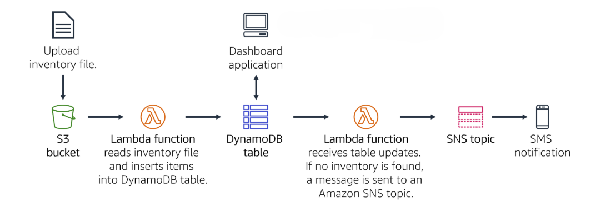
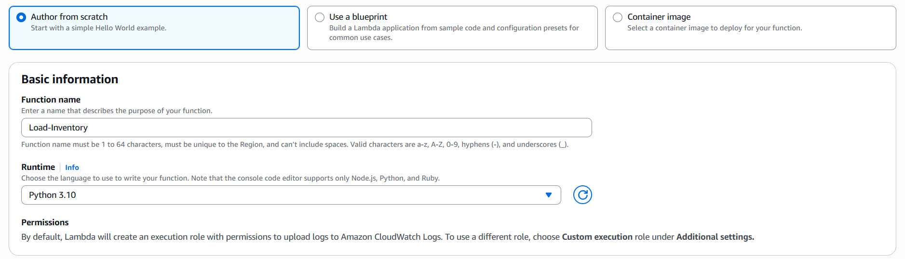
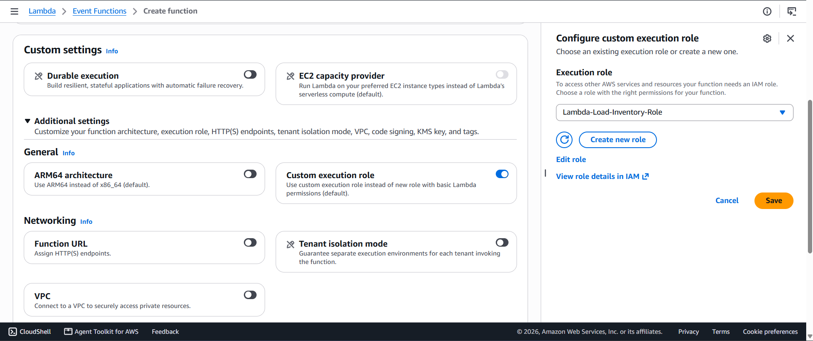
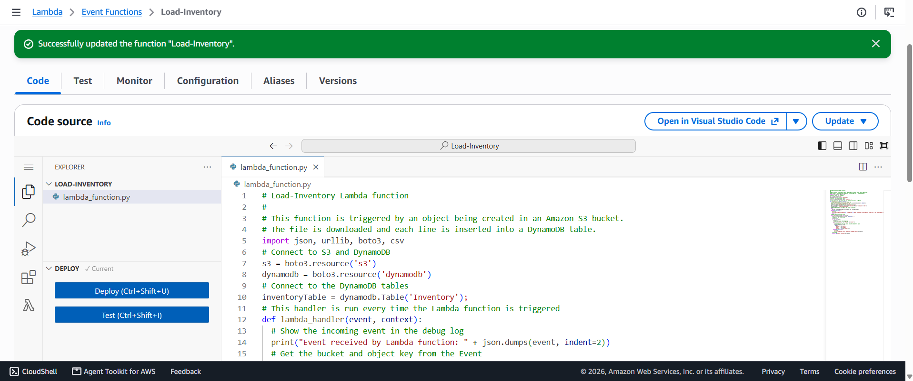
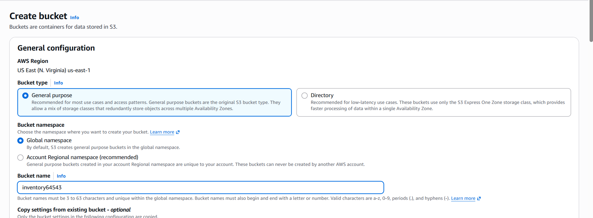
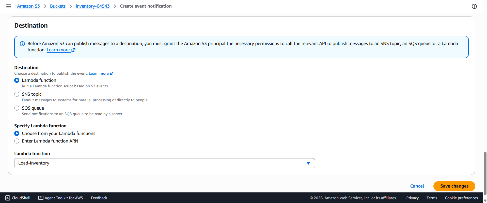
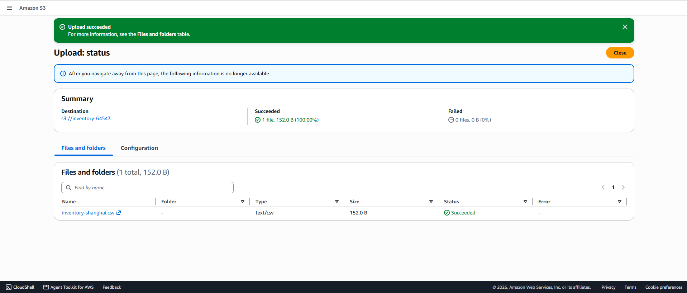
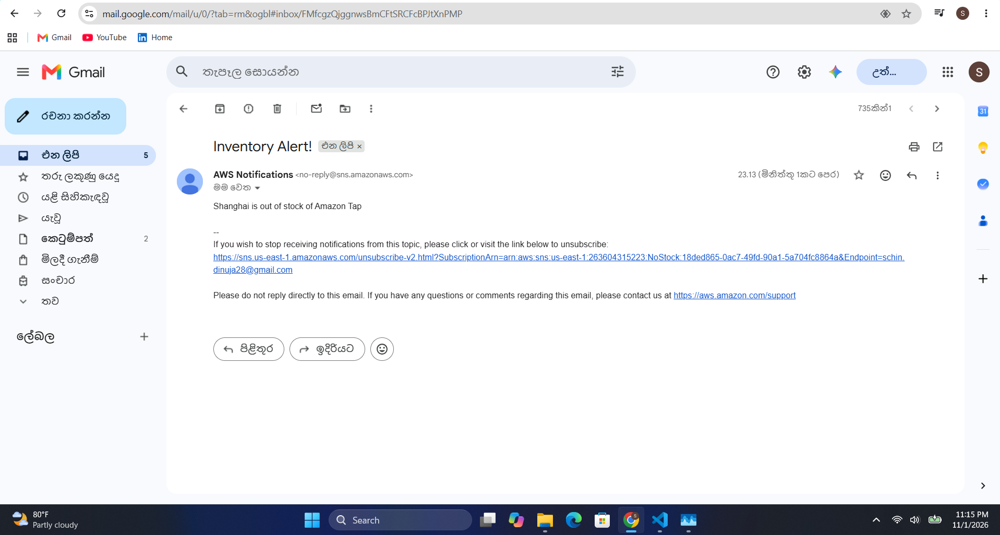

# Event-Driven Serverless Inventory Tracking System on AWS

A fully serverless, event-driven inventory ingestion and real-time stock alerting pipeline built using **Amazon S3, AWS Lambda (Python/Boto3), Amazon DynamoDB (with DynamoDB Streams), Amazon SNS, and AWS IAM**.

Automatically processes store inventory uploads via S3, syncs with DynamoDB, updates a live Dashboard, and triggers real-time SNS notifications for out-of-stock items.

## Architecture Diagram



### Workflow
1. **Data Upload:** Global retail stores upload CSV inventory files to an **Amazon S3** bucket.
2. **Automated Ingestion:** S3 Object Creation events trigger the `Load-Inventory` **AWS Lambda** function.
3. **Database Write:** Lambda parses CSV rows and updates the **Amazon DynamoDB** `Inventory` table.
4. **Stream Processing:** Item-level updates in the DynamoDB table are captured in real time via **DynamoDB Streams**, which automatically trigger the decoupled `Check-Stock` **AWS Lambda** function.
5. **Real-time Alerting:** If `Count == 0`, `Check-Stock` Lambda publishes a notification to **Amazon SNS**, triggering instant Email/SMS alerts.

---

## Step-by-Step Implementation Guide

### Step 1: Configuring IAM Roles & Policies
Before provisioning compute resources, create the execution roles required for both Lambda functions.

#### A. Create `Lambda-Load-Inventory-Role`
1. Open the **IAM Console** -> **Roles** -> **Create role**.
2. Select **AWS service** and choose **Lambda** as the use case.
3. Attach the following **AWS Managed Policies**:
   - `AmazonDynamoDBFullAccess`
   - `AmazonS3ReadOnlyAccess`
4. Name the role `Lambda-Load-Inventory-Role` and create it.
5. Open the created role -> **Add permissions** -> **Create inline policy** -> Switch to the **JSON** tab and paste the following CloudWatch Logs policy (`CWLogsPolicy`):

```json
{
    "Version": "2012-10-17",
    "Statement": [
        {
            "Action": [
                "logs:CreateLogGroup",
                "logs:CreateLogStream",
                "logs:PutLogEvents"
            ],
            "Resource": "arn:aws:logs:*:*:*",
            "Effect": "Allow"
        }
    ]
}
```

#### B. Create `Lambda-Check-Stock-Role`
1. Open the **IAM Console** -> **Roles** -> **Create role**.
2. Select **AWS service** and choose **Lambda** as the use case.
3. Attach the following **AWS Managed Policies**:
   - `AmazonSNSFullAccess`
   - `AWSLambdaDynamoDBExecutionRole`
4. Name the role `Lambda-Check-Stock-Role` and create it.

---

### Step 2: Creating the Data Ingestion Lambda Function (`Load-Inventory`)
This function is triggered whenever an inventory CSV file is uploaded to S3, parsing each row into the DynamoDB table.

1. Navigate to **AWS Lambda** -> **Create function** -> **Author from scratch**.
2. Configure the settings:
   - **Function name:** `Load-Inventory`
   - **Runtime:** `Python 3.x`
   - **Execution role:** Use an existing role -> `Lambda-Load-Inventory-Role`
3. Choose **Create function**.






4. Paste the ingestion code from [`src/lambda_load_inventory/lambda_function.py`](src/lambda_load_inventory/lambda_function.py) and click **Deploy**.



---

### Step 3: Configuring the Amazon S3 Bucket & Event Notification
1. Navigate to **Amazon S3** -> **Create bucket**.
2. Enter a globally unique bucket name (e.g., `inventory-store-bucket-xyz`) and choose **Create bucket**.



3. Open the bucket -> **Properties** tab -> Scroll down to **Event notifications** -> **Create event notification**.
4. Configure the notification settings:
   - **Event name:** `Load-Inventory`
   - **Event types:** Check **All object create events** (`s3:ObjectCreated:*`)
   - **Destination:** Lambda Function -> `Load-Inventory`
5. Choose **Save changes**. *(See [`docs/screenshots/s3-bucket.png`](docs/screenshots/Create-event-notification-S3-bucket.png) for reference)*



---

### Step 4: Configuring Amazon DynamoDB & Streams
1. Navigate to **Amazon DynamoDB** -> **Tables** -> **Create table**.
2. Configure settings:
   - **Table name:** `Inventory`
   - **Partition key:** `Store` (`String`)
   - **Sort key:** `Item` (`String`)
3. Under **Exports and streams** -> **DynamoDB stream details**, enable the stream (`New and old images` / `New image`) so updates can be captured by streams.

---

### Step 5: Configuring Amazon SNS for Low-Stock Alerts
1. Navigate to **Simple Notification Service (SNS)** -> **Topics** -> **Create topic**.
2. Configure the topic:
   - **Type:** `Standard`
   - **Name:** `NoStock`
3. Choose **Create topic**.
4. Inside the `NoStock` topic page, choose **Create subscription**:
   - **Protocol:** `Email`
   - **Endpoint:** Enter your personal/work email address
5. Choose **Create subscription**, then open your email inbox and click **Confirm subscription**.

---

### Step 6: Creating the Stock-Monitoring Lambda Function (`Check-Stock`)
Instead of overloading the ingestion function with notification logic, this decoupled function reads from the DynamoDB Stream and publishes alerts when an item count reaches zero.

1. Navigate to **AWS Lambda** -> **Create function** -> **Author from scratch**.
2. Configure the settings:
   - **Function name:** `Check-Stock`
   - **Runtime:** `Python 3.x`
   - **Execution role:** Use an existing role -> `Lambda-Check-Stock-Role` *(ensure it has DynamoDB Stream read permissions and SNS publish permissions)*.
3. Choose **Create function**.
4. Paste the monitoring code from [`src/lambda_check_stock/lambda_function.py`](src/lambda_check_stock/lambda_function.py) and choose **Deploy**.
5. In the **Function overview** section at the top, choose **Add trigger**:
   - **Select a source:** `DynamoDB`
   - **DynamoDB table:** `Inventory`
6. Choose **Add** to activate the stream trigger.

---

### Step 7: Testing the System
1. Download a sample CSV file containing an item with `count=0` (e.g., `inventory-berlin.csv`).
2. Upload the file to your **S3 bucket**.



3. Verify that the `Load-Inventory` Lambda processed the file and inserted records into the **DynamoDB** `Inventory` table.
4. Verify that when an item with a `0` count is inserted, the `Check-Stock` Lambda triggers via **DynamoDB Streams** and dispatches an instant alert email via **Amazon SNS**. *(See [`docs/screenshots/received-email.png`](docs/screenshots/received-email.png) for verification)*

